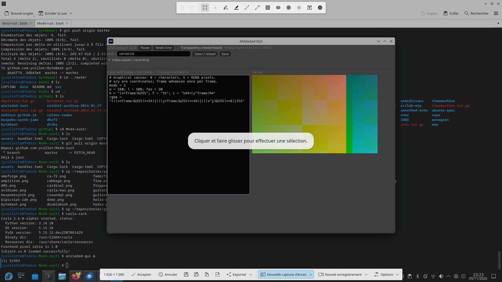

# ANSIedad (Rust)

A native Rust port of [gabochi/ANSIedad](https://github.com/gabochi/ANSIedad),
a live-coding visual instrument inspired by bytebeat and IBNIZ. The terminal
application renders CP437-style Unicode characters with 256-color ANSI
foregrounds and backgrounds; an optional graphical application also supports
RGBA pixels. No audio device is needed.



## Installation

Install a current stable Rust toolchain, then run from this repository:

```sh
cargo install --path .
# Optional graphical application:
cargo install --path . --features gui --bin ansiedad-gui
```

Native installers are available on the
[releases page](https://github.com/ycollet/ansiedad-rust/releases).

## Quick start

```sh
cargo run --release
# Optional graphical application:
cargo run --release --features gui --bin ansiedad-gui
```

No patch file is required. Edit the starter to preview changes live.
Use Ctrl-S to save, Ctrl-P to pause/resume, and Ctrl-Q to quit.
The terminal application needs a UTF-8 terminal with a monospace font;
the GUI needs a desktop session and an OpenGL-capable graphics driver.

## Documentation

- [Usage, shortcuts, patch syntax, examples, and video export](DOCUMENTATION.md)
- [Development](DOCUMENTATION.md#development)
- [CI and release procedure](.github/README.md)
- [Attribution and license](DOCUMENTATION.md#attribution-and-license)
- [GNU Affero General Public License v3.0](LICENSE)
